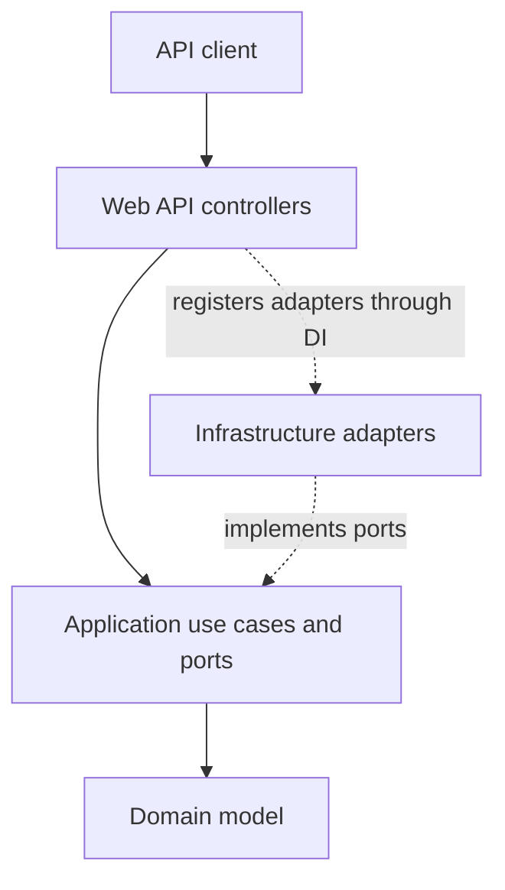

# ATM Backend

<p align="center">
  <strong>An ASP.NET Core backend for account and ATM operations, designed around Hexagonal Architecture.</strong>
</p>

<p align="center">
  
  
  
  
  
</p>

## Overview

ATM Backend is a multi-project ASP.NET Core application that supports account
management, session-based access and basic banking operations.

The project focuses on architectural boundaries rather than infrastructure
complexity. Business rules are isolated from HTTP controllers and storage
details through application ports, domain entities, value objects and
dependency injection.

## Features

- administrator and user sessions with `Guid` session keys;
- account creation protected by an administrator session;
- user authentication with account number and PIN;
- balance lookup;
- deposits and withdrawals;
- transaction history;
- transaction records for successful balance-changing operations;
- HTTP error responses for invalid sessions, denied access and invalid input;
- Swagger UI in the development environment.

## Architecture



The dependency direction is:

```text
WebApi → Application → Domain
   │
   └──→ Infrastructure → Application ports
```

### Domain

Contains the business model and does not depend on ASP.NET or data-access
implementations.

Main entities:

- `Account` — account state, PIN verification, deposits and withdrawals;
- `Session` — administrator or user session;
- `Transaction` — immutable operation record with resulting balance.

Value objects:

- `AccountNumber`;
- `PinCode`;
- `Money`.

Domain operations return explicit result types instead of relying on exceptions
for expected business outcomes.

### Application

Contains use cases and storage abstractions:

- account creation and balance retrieval;
- user and administrator session creation;
- session validation;
- deposits and withdrawals;
- transaction history retrieval;
- `IAccountRepository`;
- `ISessionRepository`;
- `ITransactionRepository`;
- `IAdminPasswordProvider`.

Application services depend only on repository interfaces, so business logic is
independent of the current storage mechanism.

### Infrastructure

Implements application ports:

- `InMemoryAccountRepository`;
- `InMemorySessionRepository`;
- `InMemoryTransactionRepository`;
- `AdminPasswordProvider`.

Adapters are registered through module-level
`IServiceCollection` extension methods.

### Web API

Contains ASP.NET Core controllers, request/response models and the application
composition root. Controllers translate HTTP requests into application use-case
calls and map typed results to HTTP responses.

## Project Structure

```text
Lab5/
├── Domain/
│   ├── Entities/
│   ├── ResultType/
│   └── ValueObjects/
├── Application/
│   ├── Abstractions/
│   ├── Application/
│   │   ├── UseCases/
│   │   └── ResultType/
│   ├── Dto/
│   └── Mapping/
├── Infrastructure/
│   ├── Authentication/
│   ├── DataAccess/
│   └── Extensions/
└── WebApi/
    ├── Controllers/
    ├── Models/
    │   ├── Requests/
    │   └── Responses/
    └── Program.cs
```

## API

### Sessions

| Method | Endpoint | Access | Description |
|---|---|---|---|
| `POST` | `/api/Sessions/admin` | Public | Create an administrator session |
| `POST` | `/api/Sessions/user` | Public | Create a user session using account number and PIN |

### Accounts

| Method | Endpoint | Access | Description |
|---|---|---|---|
| `POST` | `/api/Accounts/create` | Administrator | Create an account |

### Operations

| Method | Endpoint | Access | Description |
|---|---|---|---|
| `GET` | `/api/Operations/balance` | User | Get the current balance |
| `POST` | `/api/Operations/deposit` | User | Deposit money |
| `POST` | `/api/Operations/withdraw` | User | Withdraw money |
| `GET` | `/api/Operations/history` | User | Get transaction history |

Protected endpoints use:

```text
X-Session-Key: <session-guid>
X-Account-Number: <account-number>
```

Account creation requires only the administrator session key.

## Request Examples

### Create an administrator session

```bash
curl -X POST http://localhost:5067/api/Sessions/admin \
  -H "Content-Type: application/json" \
  -d '{
    "password": "<ADMIN_PASSWORD>"
  }'
```

### Create an account

```bash
curl -X POST http://localhost:5067/api/Accounts/create \
  -H "Content-Type: application/json" \
  -H "X-Session-Key: <ADMIN_SESSION_KEY>" \
  -d '{
    "accountNumber": "40817810000000000001",
    "pin": "1234",
    "initialBalance": 1000
  }'
```

### Create a user session

```bash
curl -X POST http://localhost:5067/api/Sessions/user \
  -H "Content-Type: application/json" \
  -d '{
    "accountNumber": "40817810000000000001",
    "pin": "1234"
  }'
```

### Deposit money

```bash
curl -X POST http://localhost:5067/api/Operations/deposit \
  -H "Content-Type: application/json" \
  -H "X-Session-Key: <USER_SESSION_KEY>" \
  -H "X-Account-Number: 40817810000000000001" \
  -d '{
    "amount": 250
  }'
```

## Local Run

### Requirements

- .NET SDK 9.0

### Start the API

```bash
git clone https://github.com/Alexandr-prog34/atm-backend.git
cd atm-backend

dotnet restore
dotnet run --project Lab5/WebApi/Lab5.WebApi.csproj --launch-profile http
```

The development endpoints are:

```text
API:        http://localhost:5067
Swagger UI: http://localhost:5067/swagger
```

## Engineering Decisions

### Explicit ports and adapters

Repository contracts are defined in the Application layer, while in-memory
implementations live in Infrastructure. A persistent adapter can therefore
replace the current implementation without changing application use cases.

### Domain behavior inside entities

Balance-changing rules belong to `Account`, not to controllers. `Money`,
`AccountNumber` and `PinCode` prevent primitive values from spreading through
the domain model.

### Typed operation results

Session creation, deposits and withdrawals use closed result hierarchies. The
Web API layer maps these results to HTTP responses without coupling the domain
to ASP.NET types.

### Module-owned dependency registration

Application and Infrastructure expose their own dependency-injection extension
methods. `Program.cs` composes the modules without knowing every concrete
registration.

## Testing

The intended test boundary is the Domain and Application layers. Repository
interfaces allow use cases to be tested with substitutes instead of real
storage or HTTP requests.

The current project archive does not yet contain the required test project.
The primary test cases to add with
[NSubstitute](https://www.nuget.org/packages/NSubstitute) are:

- successful withdrawal updates and saves the account;
- withdrawal with insufficient funds returns an error;
- successful deposit updates and saves the account;
- successful balance-changing operations create transaction records.

## Current Limitations

- repositories store data only for the lifetime of the application process;
- the administrator password adapter still needs configuration-based secret handling;
- user operations should derive the target account directly from the validated session;
- sessions do not currently expire;
- concurrent balance updates are not synchronized;
- automated tests and CI are not yet included.

## Roadmap

- add unit tests with NSubstitute;
- move the administrator password to configuration or secret storage;
- enforce session-to-account ownership in the Application layer;
- add session expiration;
- implement a persistent repository adapter;
- add validation middleware and unified error responses;
- add GitHub Actions for build and test checks.

## Tech Stack

```text
C#
.NET 9
ASP.NET Core Web API
Microsoft.Extensions.DependencyInjection
Swagger / OpenAPI
In-memory repositories
```
