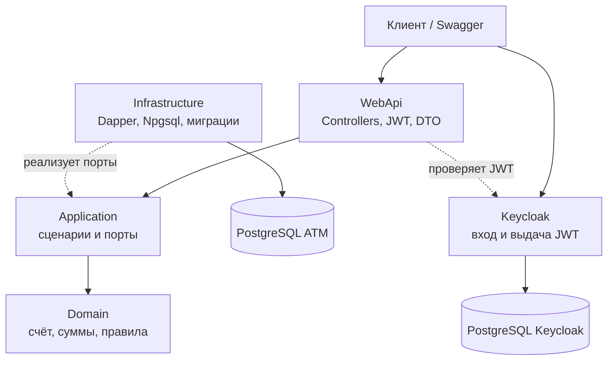
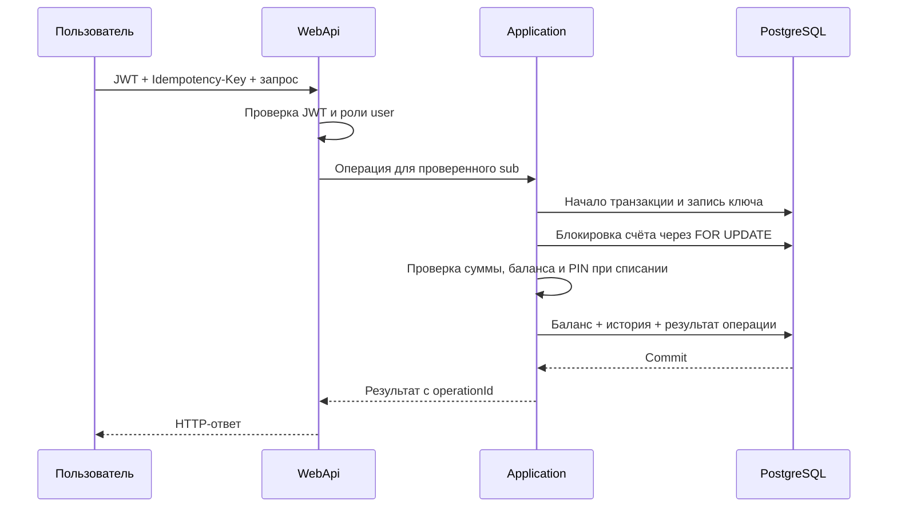

# ATM Backend

<p align="center">
  <strong>Backend банковских счетов и денежных операций на ASP.NET Core с PostgreSQL и Keycloak.</strong>
</p>

<p align="center">
  
  
  
  
  
  
</p>

**Автор:** Alexandr Plotnikov.

## О проекте

ATM Backend — учебный проект, развитый до backend-сервиса с постоянным хранением данных, транзакционными денежными операциями и проверкой доступа к счёту. Для первой версии поддерживается одна валюта — **RUB**, суммы с точностью до копейки. Один пользователь Keycloak (`sub`) может владеть одним счётом.

### Возможности

- Администратор создаёт счёт для пользователя Keycloak.
- Пользователь видит баланс и историю только своего счёта, пополняет его, снимает деньги и переводит их на другой счёт.
- Снятие и перевод требуют PIN. После пяти ошибок ввод PIN блокируется на 15 минут. PIN хранится как хеш PBKDF2 с индивидуальной солью.
- Повтор денежного POST-запроса с тем же `Idempotency-Key` возвращает исходный результат без повторного изменения баланса.
- Баланс и история сохраняются в одной транзакции PostgreSQL. При переводе обе строки счетов блокируются в постоянном порядке.

## Архитектура



Зависимости кода направлены к бизнес-логике: `WebApi → Application → Domain`, `Infrastructure → Application / Domain`. Контроллеры работают со сценариями Application, а SQL и миграции находятся в Infrastructure. В этом проекте для доступа к данным используются **Dapper, Npgsql и FluentMigrator**.

### Стек

| Компонент | Реализация |
|---|---|
| API | ASP.NET Core Controllers, Swagger / OpenAPI |
| Аутентификация | Keycloak, OIDC Authorization Code + PKCE, JWT Bearer |
| Данные | PostgreSQL, Npgsql, Dapper, FluentMigrator |
| Тесты | xUnit, NSubstitute, Testcontainers PostgreSQL, WebApplicationFactory |
| Локальный запуск и CI | Docker Compose, GitHub Actions |

### Слои

| Слой | Ответственность |
|---|---|
| [Domain](src/Domain) | Сущности `Account` и `Transaction`, объекты `Money`, `AccountNumber`, `PinCode` и бизнес-правила |
| [Application](src/Application) | Создание счёта, баланс, история, денежные операции и интерфейсы хранилищ |
| [Infrastructure](src/Infrastructure) | SQL-запросы, транзакции PostgreSQL, репозитории и миграции |
| [WebApi](src/WebApi) | Контроллеры, DTO, JWT, роли, HTTP-ошибки, Swagger и health check |

### Структура репозитория

```text
.
├── src/
│   ├── Domain/
│   ├── Application/
│   ├── Infrastructure/
│   │   └── DataAccess/FluentMigrations/
│   └── WebApi/
├── tests/
│   ├── ATM.UnitTests/
│   └── ATM.IntegrationTests/
├── keycloak/realm.json
├── scripts/bootstrap-keycloak.sh
├── compose.yaml
├── Dockerfile
└── ATM.slnx
```

## Как проходят денежные операции



При переводе оба счёта блокируются в постоянном порядке; списание, зачисление и две записи истории фиксируются одной транзакцией с общим `operationId`. Ключи идемпотентности и результаты хранятся в PostgreSQL, поэтому повтор после перезапуска не проводит операцию ещё раз. Неуспешная операция не меняет баланс. Ненулевой начальный баланс отражается в истории записью `opening`.

## Локальный запуск

Нужны Docker и Docker Compose. Скопируйте пример конфигурации и замените **все** значения `replace-with-...` на разные случайные пароли. Например, пароль можно сгенерировать командой `openssl rand -base64 32`.

```bash
cp .env.example .env
# Заполнить пароли в .env
docker compose up --build -d
docker compose ps
curl http://localhost:8080/health/ready
```

| Адрес | Назначение |
|---|---|
| <http://localhost:8080/swagger> | Swagger UI и вход через Keycloak |
| <http://localhost:8081/admin/> | Консоль администратора Keycloak |
| <http://localhost:8081/realms/atm/.well-known/openid-configuration> | OIDC discovery |

Compose поднимает **две отдельные базы PostgreSQL** с разными пользователями: одну для ATM, другую для Keycloak. Файл [.env.example](.env.example) содержит только шаблон; `.env` исключён из Git и Docker build context. Данные обеих баз сохраняются в Docker volumes между перезапусками. Настройка рассчитана на локальную разработку по HTTP на `localhost`.

При первом запуске Keycloak импортирует [realm.json](keycloak/realm.json). Контейнер bootstrap создаёт тестовых пользователей с именами из `ATM_TEST_USER_NAME` и `ATM_TEST_ADMIN_NAME` и паролями из `.env`. Учётная запись `KEYCLOAK_ADMIN_USER` управляет самим Keycloak; она не является отдельным администратором ATM. Новые пользователи и роли также создаются в Keycloak. Если меняете имя realm или клиента в `.env`, согласуйте его с `realm.json`: импорт уже существующего realm при повторном старте не заменяет его настройки.

## Вход и проверка API

Keycloak выдаёт JWT через **OIDC Authorization Code Flow с PKCE**. API проверяет подпись, issuer, audience и срок действия токена, преобразует роли Keycloak в роли ASP.NET Core и определяет счёт по проверенному `sub`. ATM Backend не выдаёт собственные токены и не хранит локальные HTTP-сессии.

1. Откройте Swagger и нажмите **Authorize**. Вход идёт через Keycloak с Authorization Code Flow и PKCE (`S256`). Войдите как `atm-admin` для создания счёта или как `atm-user` для операций со счётом. Фактические имена и пароли смотрите в своём `.env`.
2. В Keycloak Admin Console откройте пользователя `atm-user` и скопируйте его **User ID**. Это значение `sub` в JWT.
3. В Swagger под `atm-admin` вызовите `POST /api/accounts` с `ownerSubject`, равным User ID из предыдущего шага:

```json
{
  "accountNumber": "40817810000000000001",
  "ownerSubject": "USER_ID_ИЗ_KEYCLOAK",
  "pin": "1234",
  "initialBalance": 100.00
}
```

4. Войдите в Swagger как `atm-user` и вызовите `GET /api/accounts/me/balance`. Для пополнения передайте сумму и уникальный заголовок `Idempotency-Key`. Для снятия и перевода дополнительно передайте PIN в теле запроса.

Рабочие примеры запросов для HTTP-клиента IDE находятся в [Lab5.WebApi.http](src/WebApi/Lab5.WebApi.http). Чтобы выполнить запрос через `curl`, сначала получите access token через Swagger или OIDC Authorization Code + PKCE, затем передайте его в заголовке:

```bash
curl -i http://localhost:8080/api/accounts/me/balance \
  -H "Authorization: Bearer $USER_TOKEN"

curl -i -X POST http://localhost:8080/api/accounts/me/withdrawals \
  -H "Authorization: Bearer $USER_TOKEN" \
  -H 'Content-Type: application/json' \
  -H 'Idempotency-Key: withdrawal-example-001' \
  -d '{"amount":10.00,"pin":"1234"}'
```

Для ручного получения токена по PKCE нужны `code_verifier`, его SHA-256 `code_challenge`, переход в `.../protocol/openid-connect/auth` и обмен одноразового `code` в `.../protocol/openid-connect/token`. Swagger выполняет эти шаги автоматически.

## HTTP API

| Метод | Путь | Роль | Назначение |
|---|---|---|---|
| `POST` | `/api/accounts` | `admin` | Создать счёт для `ownerSubject` |
| `PUT` | `/api/accounts/{id}/owner` | `admin` | Привязать старый счёт к пользователю Keycloak |
| `GET` | `/api/accounts/me/balance` | `user` | Баланс |
| `GET` | `/api/accounts/me/transactions?offset=0&limit=50` | `user` | История, сначала новые записи |
| `POST` | `/api/accounts/me/deposits` | `user` | Пополнение: `{ "amount": 25.50 }` |
| `POST` | `/api/accounts/me/withdrawals` | `user` | Снятие: `{ "amount": 10.00, "pin": "1234" }` |
| `POST` | `/api/accounts/me/transfers` | `user` | Перевод: номер получателя, сумма и PIN |

Денежные POST-запросы требуют `Idempotency-Key` длиной до 200 символов. Повтор с тем же ключом и параметрами возвращает прежний результат; другой набор параметров с тем же ключом даёт `409 Conflict`. Некорректная сумма даёт `400`, недостаток средств — `409`, неправильный PIN — `403`, временная блокировка PIN — `429`. Ошибки HTTP возвращаются как `ProblemDetails`. API выбирает счёт пользователя **только по проверенному `sub`**, поэтому передача чужого номера счёта в заголовке не даёт доступа.

Ненулевой начальный баланс записывается в историю как `opening`. При переводе списание, зачисление и две записи истории имеют общий `operationId` и фиксируются одной транзакцией. Для защиты от параллельных операций используется PostgreSQL `SELECT … FOR UPDATE`; ключи идемпотентности также хранятся в PostgreSQL. PIN и токены не записываются в историю операций и логи.

## База данных и миграции

Миграции FluentMigrator применяются при запуске API. [Базовая миграция](src/Infrastructure/DataAccess/FluentMigrations/M00001_BaselineAtmSchema.cs) создаёт таблицы счетов, операций и идемпотентности. [Миграция Keycloak](src/Infrastructure/DataAccess/FluentMigrations/M00002_KeycloakOwnerAndPinLock.cs) добавляет владельца и состояние блокировки PIN. Она сохраняет старые счета и историю, но удаляет таблицу старых HTTP-сессий. У старых счетов `owner_sub` пуст: администратор должен привязать их через `PUT /api/accounts/{id}/owner`.

Данные можно посмотреть напрямую:

```bash
docker compose exec atm-postgres sh -c 'psql -U "$POSTGRES_USER" -d "$POSTGRES_DB" -c "SELECT number, owner_sub, balance FROM accounts"'
docker compose exec atm-postgres sh -c 'psql -U "$POSTGRES_USER" -d "$POSTGRES_DB" -c "SELECT operation_id, type, amount, balance_after FROM financial_transactions ORDER BY occurred_at_utc DESC LIMIT 10"'
```

## Тестирование и CI

```bash
dotnet build ATM.slnx
dotnet test ATM.slnx
dotnet format whitespace ATM.slnx --verify-no-changes
```

Unit-тесты на xUnit и NSubstitute не требуют Docker. Интеграционные тесты запускают PostgreSQL через Testcontainers и проверяют HTTP API через WebApplicationFactory; для них Docker должен быть доступен. JWT в этих тестах подписывается тестовым ключом, поэтому работающий Keycloak не нужен. GitHub Actions выполняет сборку, тесты и проверку форматирования.

Kafka, Redis и Kubernetes в этой версии не используются.
